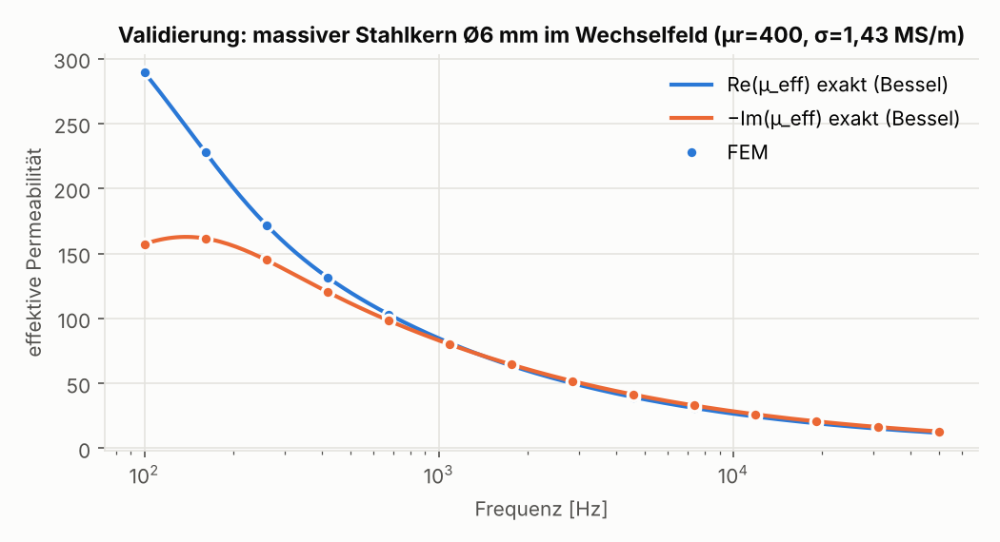
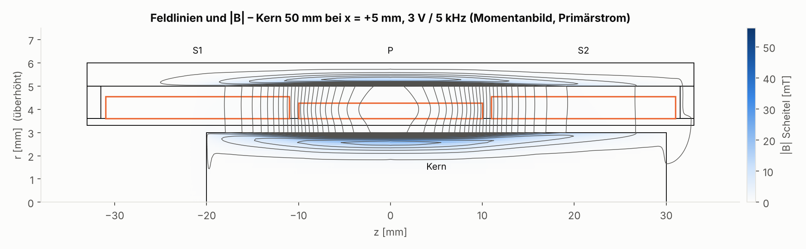
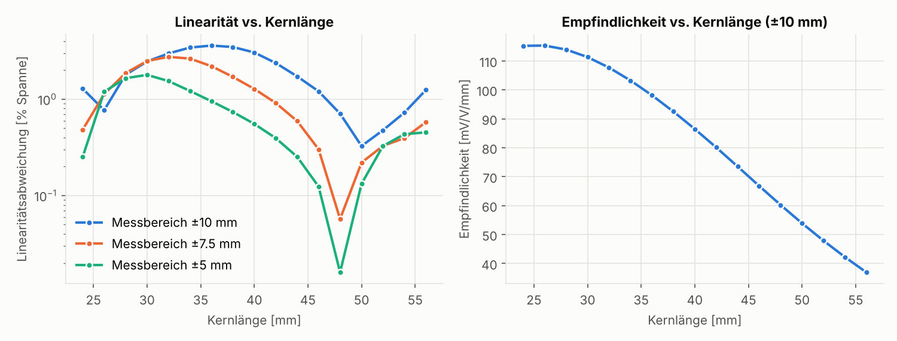
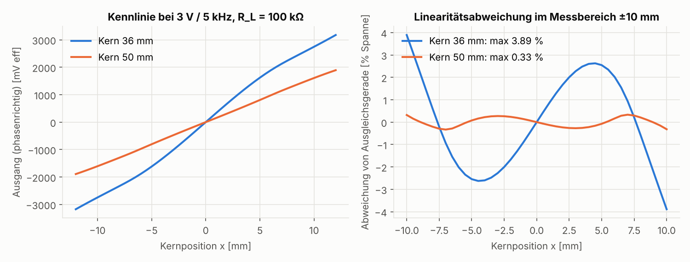
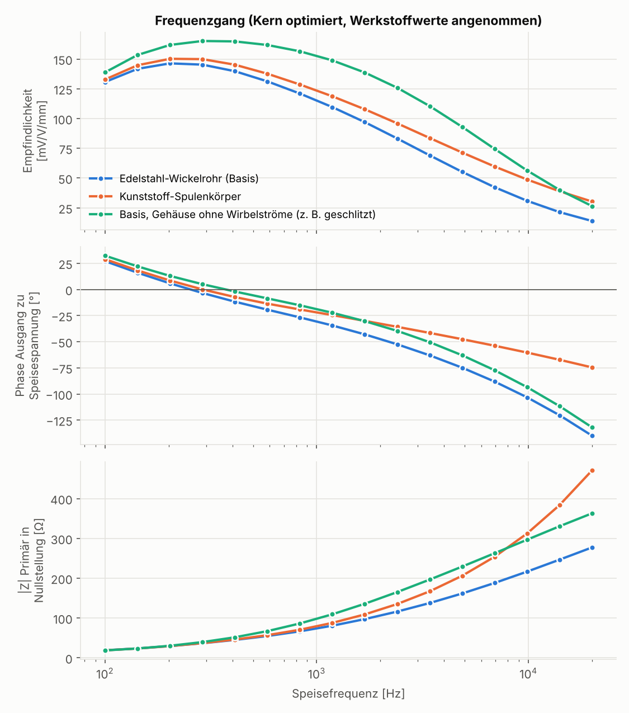
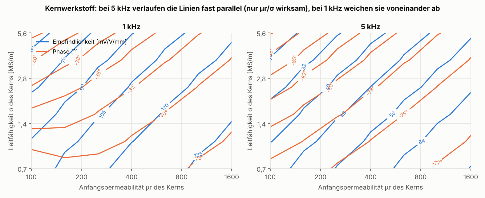

# Phase 1 – Feasibility Analysis: Simulation and Design Tool for LVDTs

_English translation of [docs/phase1/01_Machbarkeitsanalyse.md](../../phase1/01_Machbarkeitsanalyse.md). The German original remains authoritative._

Status: 24 Oct 2026 · Project MESSOTRON R&D · Phase 1 completed, open questions pending
Accompanying documents: [02_data_requirements.md](02_data_requirements.md) ·
[03_open_questions.md](03_open_questions.md)

---

## 0. Summary

**Yes, a valid electromagnetic model can be derived from the winding data.**
An LVDT is fully described physically: quasi-static Maxwell equations with eddy currents
in a nearly axisymmetric arrangement. No equations are missing. What is unknown are the
**material parameters** (your core and housing steels are not magnetically specified), and a
**clean mapping** of measurement data to winding, core and measurement conditions is needed.

I did not merely assess feasibility but demonstrated it with a solver-core prototype
(`lvdt_sim/`, Section 4):

- **Physics correct:** Eddy currents in the solid core deviate at most 0.14% from the exact
  Bessel solution (100 Hz … 50 kHz). Mutual inductances of air-core coils deviate less than
  0.7% from the analytical filament model.
- **Numerically clean:** With a 2.5× finer mesh, the sensitivity changes by 0.006%, the
  phase by 0.03° and the linearity deviation by 0.004% of span. For symmetric designs the
  null position is numerically exact.
- **Fast enough for design work:** about 1 s per core position; a complete characteristic
  curve with 40 points in under one minute on an ordinary 4-core computer.
- **Delivers the required quantities:** characteristic curve, linearity, sensitivity, phase,
  frequency response, primary impedance and current consumption. The winding is built
  turn by turn from traverse paths (CNC logic).
- **Usable as a design tool:** On the fictitious demo LVDT (±10 mm), optimizing the core
  length alone reduces the linearity deviation from 3.9% to 0.33% of span (Section 4.3).
- **Reveals what is hard to see in experiments:** With a lossy core, the output phase can
  change over the stroke. The same simulated sensor then shows 0.22%, 0.33% or 12.5%
  linearity deviation depending on the measurement chain (Section 2.6). For comparison with
  the database, the signal evaluation of the measurement chain must therefore be known
  exactly.

**Conditions for a validated model of your real sensors:**

1. **Material calibration:** Initial permeability, conductivity and losses of the core and
   housing materials are identified from your measurement data, not taken from data sheets.
   Important finding from Phase 1: at usual excitation frequencies (≥ 5 kHz) the core acts
   almost exclusively via the ratio µr/σ. The most robust way to separate the two values is
   to **measure σ directly on the core rod** (simple 4-wire measurement) and then determine
   µr from the characteristic curve and phase. Measurements at a second, lower frequency
   help additionally (Section 5).
2. **Known measurement conditions** of the database: excitation voltage, frequency,
   measurement electronics and **type of demodulation** (rectifying or phase-sensitive,
   phase adjustment), load.
3. **Rotational symmetry** of the design. Slots and cable exits must be assessed separately.
4. **Reconstructable winding** from the winding instruction and CNC program: layers,
   pitches, winding direction, interconnection. According to your description this is
   the case.
5. **Check of the excitation level:** The field strength in the core reaches about
   100–170 A/m at 3 V excitation (Section 2.5). This is in the range where the permeability
   of steels without final annealing becomes level-dependent. This is checked with a
   measurement at two excitation voltages and, if necessary, taken into account in the
   model.

**Recommendation:** Proceed with Phase 2 (data transfer and import for 3–5 reference
sensors) as soon as the open questions ([03_open_questions.md](03_open_questions.md)) are
resolved.

---

## 1. Starting Point and Target Vision

MESSOTRON has so far developed its LVDT windings iteratively: wind a sample, measure,
adjust. Many of these designs have been running reliably for years. What is missing is a
tool that predicts how a winding will behave before the first sample is built.

The target vision in three stages:

1. **Recalculation (digital twin):** Compute existing coils from the winding program,
   geometry and core: characteristic curve, linearity, sensitivity, phase, primary
   impedance, favorable excitation frequency. Comparison with the measurement database.
2. **Variant calculation:** Starting from a validated design, change individual parameters,
   such as core material, core length or diameter, coil former (stainless steel ↔ plastic),
   frequency, numbers of turns or winding-traverse formula.
3. **Design/optimization:** Generate a winding proposal from target specifications (stroke,
   sensitivity, linearity, installation space) and optionally output it as a CNC program.

## 2. Physics of Your Design: What Determines Characteristic Curve, Sensitivity and Phase

### 2.1 Principle

The primary coil is excited with the voltage U_P. The core couples it to the secondary
coils S1 and S2 with varying strength. For the series-opposition connection:

    U_out(x) = jω · [M₂(x) − M₁(x)] · I_P(x),     I_P(x) = U_P / Z_P(x)

M₁, M₂ are the mutual inductances, Z_P is the primary impedance. All three depend on the
core position x and are **complex** because of the eddy currents. The model computes them
directly as the impedance matrix Z(x, f) of the three coils. Any circuit configuration
follows from this: source impedance, load, cable, and later also signal-conditioning
electronics.

### 2.2 Solid Steel Core: Eddy Currents and Skin Effect

Your cores are made of solid, high-permeability steels, not ferrite or mu-metal. At kHz
frequencies the alternating flux penetrates only a thin surface layer:

| Material (assumed values) | 1 kHz | 2.5 kHz | 5 kHz | 10 kHz | 20 kHz |
|---|---|---|---|---|---|
| Core, ferritic stainless steel (e.g. 1.4105), µr = 400, σ = 1.43 MS/m | 0.67 mm | 0.42 mm | 0.30 mm | 0.21 mm | 0.15 mm |
| same with µr = 150 | 1.09 mm | 0.69 mm | 0.49 mm | 0.34 mm | 0.24 mm |
| Housing, free-cutting steel (e.g. 1.0718), µr = 300, σ = 5 MS/m | 0.41 mm | 0.26 mm | 0.18 mm | 0.13 mm | 0.09 mm |
| Coil former tube, austenitic stainless steel, µr = 1.05, σ = 1.4 MS/m | 13 mm | 8.3 mm | 5.9 mm | 4.2 mm | 2.9 mm |

*Skin depth δ = 1/√(π f µ₀ µr σ)*

Consequences:

- A core of Ø 6 mm carries the flux at 5 kHz practically only in the outer 0.3–0.5 mm.
  The **effective permeability is complex and frequency-dependent**. At 5 kHz, in the
  validation example, it is only |µ_eff| ≈ 55 instead of 400, with −44° phase
  (Figure [06](../../phase1/img/06_validierung_bessel.png)).
- This explains why your sensors exhibit **phase shift and eddy-current losses** and are
  nevertheless highly linear. Linearity is predominantly a matter of geometry (winding
  distribution, core length). The material losses mainly affect sensitivity and phase.
  An important exception is described in Section 2.6.
- **Same effect, different causes:** With strong skin effect, the behavior depends
  approximately only on √(µr/σ). Measurements at a single high frequency cannot
  distinguish a high-permeability, highly conductive core from a less permeable, less
  conductive one. This has consequences for calibration (Section 5).

### 2.3 Stainless Steel Coil Former Tube: Shorted Turn

Electrically, the thin stainless steel tube is a closed turn around the core. A simple
estimate without core (τ = µ₀σ·r·t/2 ≈ 0.9 µs at r = 3.45 mm, t = 0.3 mm) yields only
≈ 1.6° phase at 5 kHz. **With the core, the effect is many times larger.** The tube
encloses the entire core flux, and the voltage in this shorted turn rises accordingly. In
the demo LVDT, the stainless steel tube at 5 kHz costs **about 23% sensitivity and 27°
phase** compared with a plastic bobbin (Section 4.3,
Figure [04](../../phase1/img/04_frequenzgang.png)). The low permeability of the tube
(µr 1–1.3, depending on cold working) plays only a minor role by comparison. Wall thickness
and material of the tube are therefore important design parameters. Such coupling effects
escape a hand calculation; FEM captures them automatically.

### 2.4 Housing as a Magnetic Cage

The steel housing with end discs closes the flux path on the outside and provides
shielding. At kHz frequencies, however, eddy currents also flow there: with the assumed
values, δ ≈ 0.18 mm in a 1 mm thick wall. In the demo model, the eddy currents in the
housing at 5 kHz cost **about 40% sensitivity and 12° phase** (variant "housing without
eddy currents" in Section 4.3). Without eddy currents in core, tube and housing, the output
would be nearly in phase with the excitation (control calculation with σ = 0: transfer
impedance exactly 90°). Housing material, wall thickness and any longitudinal slot are thus
**genuine design parameters** for phase and sensitivity, and the model captures them.

### 2.5 Excitation Level (Validity of the Linear Model)

The model assumes linear materials, i.e. a constant, possibly complex permeability. In the
demo LVDT (3 V, 5 kHz, 468 primary turns, ≈ 18–22 mA) the field strength at the core
surface reaches **≈ 110–120 A/m rms (≈ 160–170 A/m peak)**, and the flux density
≈ 55–60 mT. This is far from saturation. It does, however, lie in the range of the coercive
field strength of steels without final annealing, i.e. in the **Rayleigh region**. There the
permeability increases with the excitation level, and hysteresis losses occur.

Consequences:
- The sensitivity may depend slightly on the excitation voltage.
- For calibration, the material values must be determined **at the actual excitation
  voltage**.
- If the effect is relevant, it is modeled with an amplitude-dependent permeability per
  element. This is an iterative solution, not a new model.
- Check: measure the characteristic curve or full-scale value at two excitation voltages
  ([02_data_requirements.md](02_data_requirements.md), Section 5).

### 2.6 Phase over the Stroke: The Measurement Chain Determines the Measured Linearity

The core is lossy. When its end is deeply immersed in a secondary coil, the phase of the
output voltage can change with position. For the demo LVDT with a 36 mm core it remains
nearly constant (−40° … −39°). With a 50 mm core it drifts from −81° near zero to −61° at
±10 mm. The **measured linearity** then depends on how the signal is evaluated:

| Evaluation of the identical sensor (core 50 mm, ±10 mm) | Linearity deviation |
|---|---|
| Rectification (magnitude, sign from phase position) | 0.22% of span |
| Synchronous demodulation, reference phase optimally adjusted | 0.33% |
| Synchronous demodulation, reference = excitation voltage without phase adjustment | 12.5% (signal only 49% of magnitude) |

Consequences:
- For comparison with the measurement database, the signal evaluation of the measurement
  chain must be known exactly (open question A.1). The model can reproduce any of these
  evaluations.
- In design, the tool can optimize for a **phase that is constant over the stroke**. This
  makes the sensor insensitive to the customer's signal-conditioning electronics.

### 2.7 Not Included in the Core Model, but Estimable

- **Capacitances** of the fine-wire, many-turn secondary coils: their self-resonance is
  usually far above the excitation frequency. We check this by measurement and, if
  necessary, represent it as a lumped capacitance in the network.
- **Null voltage:** It arises from asymmetries, capacitive coupling and harmonics. An
  axisymmetric model predicts only the quadrature component. We capture the remainder
  statistically from the database.
- **Temperature drift:** It can be modeled via the temperature coefficients of copper,
  steel σ and µr. This is a later expansion stage.

## 3. Comparison of Modeling Approaches

| Approach | Physical completeness | Computation time | Suitability |
|---|---|---|---|
| Analytical (filament model, Bessel core) | air-core coils exact; core, housing and stray fields only approximated | µs–ms | preliminary design, plausibility checks |
| Magnetic equivalent circuit (reluctance network) | leakage and eddy currents only via correction factors | ms | fast, but only after calibration per design type |
| **2D axisymmetric time-harmonic FEM** | complete for linear materials: eddy currents in core, tube and housing, turn-accurate winding distribution | ≈ 1 s per core position | **physical core of the digital twin** |
| 3D FEM | also non-axisymmetric details | minutes to hours | only selectively (slots, cable exit) |
| Purely data-driven (ML on measurement data) | no physics, only interpolation between known designs | ms | unsuitable for new cores/windings outside the data |
| **Hybrid: FEM + calibration on measurement data + residual error model** | physics plus your experience from tens of thousands of measurements | – | **Recommendation** |

For optimization with thousands of variants, a fast surrogate model trained on FEM
calculations can be added later.

**In-house solver or commercial software?** Commercial programs (COMSOL, Ansys Maxwell)
and the free FEMM can in principle compute LVDTs. For this goal, however, a lean in-house
solver has clear advantages: direct import of CNC programs and measurement data, automatic
recalculation of hundreds of designs, optimization loops, no license costs and full control
over calibration. Commercial tools remain useful for cross-checking.

## 4. Proof of Concept (Implemented in Phase 1)

### 4.1 What Was Built

`lvdt_sim/` is a Python package (numpy/scipy, approx. 750 lines):

- **Geometry** as rectangular regions in the r-z half-plane: coil former, chambers,
  housing, end discs, moving core including push rod.
- **Winding** as layers with sections of constant pitch. The function
  `layers_from_moves()` translates traverse paths "from z_a to z_b with N revolutions" into
  layers. A reversal of the traverse direction starts a new layer. This is the bridge to
  your CNC programs; progressive winding-traverse formulas are included.
- **FEM**: time-harmonic, axisymmetric; the unknown is the flux function r·A_φ. The mesh is
  refined at material boundaries and according to the skin depth. In the stroke range it is
  axially uniform so that moving the core does not introduce remeshing noise into the
  characteristic curve.
- **Result** per core position and frequency is the complex 3×3 impedance matrix (P, S1,
  S2). From this the package computes output voltage under load, primary current,
  individual voltages S1/S2, phase-correct (synchronous) demodulation, linearity and
  frequency response.

### 4.2 Validation

| Test | Reference | Max. deviation |
|---|---|---|
| Solid core Ø 6 mm (µr = 400, σ = 1.43 MS/m) in an axial alternating field, 100 Hz … 50 kHz | exact Bessel solution | **0.14%** (magnitude of complex µ_eff) |
| Non-magnetic stainless steel rod (µr = 1.05, σ = 1.4 MS/m), 5 kHz | Bessel solution | 0.10% |
| Mutual inductances of three air-core coils | Maxwell formula for coaxial current loops, summed over the winding cross-sections | 0.37–0.62% (remainder: finite computational domain) |
| Mesh convergence, demo LVDT (107,000 vs. 270,000 unknowns) | finer mesh | sensitivity 0.006%, phase 0.03°, linearity 0.004% of span |
| Symmetry, reciprocity, load case | null voltage, U(−x) = −U(x), Z = Zᵀ, open-circuit limit case | < 10⁻⁹ relative |

### 4.3 Demo LVDT (Fictitious, Material Values Assumed)

Construction according to your description: stainless steel coil former tube
Ø 6.6/7.2 mm, three chambers S1 | P | S2 of 20 mm each, primary coil 468 turns (Ø 0.15 mm,
4 layers), secondary coils 2100 turns each (Ø 0.08 mm, 10 layers), steel housing
Ø 10/12 mm × 66 mm with end discs, solid core Ø 6 mm. Excitation 3 V / 5 kHz, load
100 kΩ, measuring range ±10 mm.

**Core length study** (one variant calculation with 17 core lengths × 21 positions,
approx. 5 minutes):

| Core length | Sensitivity | Phase | Linearity ±10 mm | Linearity ±7.5 mm |
|---|---|---|---|---|
| 36 mm (initial design) | 98.7 mV/V/mm | −39° | 3.9% of span | 2.2% |
| 48 mm | 60.2 mV/V/mm | – | 0.71% | **0.06%** |
| **50 mm (optimum for ±10 mm)** | 53.9 mV/V/mm | −69° | **0.33%** | 0.22% |

*Sensitivity and phase from the best-fit line over ±10 mm, evaluated with phase-correct
demodulation; linearity in % of output span.*

This is the trade-off you know from practice: a longer core is more linear but less
sensitive. The tool makes it quantitatively visible and allows the winding to be optimized
against both goals, for example with a graded secondary winding instead of a chamber
winding.

**Frequency response and coil former design:**

With the assumed material values, the sensitivity maximum lies at about 200–290 Hz and the
phase zero crossing at 250–370 Hz. Above that, eddy-current losses dominate. At ≈ 5 kHz
the result is:

| Variant | Sensitivity | Phase | \|Z_P\| at null |
|---|---|---|---|
| Stainless steel coil former tube (baseline) | 55 mV/V/mm | −75° | 162 Ω |
| Plastic bobbin | 72 mV/V/mm | −48° | 206 Ω |
| Baseline with housing without eddy currents (e.g. longitudinally slotted) | 93 mV/V/mm | −63° | 229 Ω |

The figures apply only to the assumed material values. They do, however, show what the tool
answers: which frequency is favorable for a design, and how much sensitivity and phase the
coil former design and the housing cost. The phase also depends on the evaluation range
(Section 2.6). Here it is determined from the slope between ±5 mm.

**Influence of the unknown core material parameters:**

At 5 kHz the lines of equal sensitivity and equal phase run nearly parallel: both
measured quantities depend there almost exclusively on µr/σ, so a single measurement does
not separate µr and σ. At 1 kHz the directions diverge, especially at low conductivity.
Magnitude and phase at two frequencies thus make the separation possible, but only weakly.
**The robust approach is to measure σ directly on the core rod.** Then µr remains as the
only core unknown, and it can be determined well from the characteristic curve and phase.

### 4.4 What the Prototype Does Not (Yet) Do

- It is **not matched to real MESSOTRON sensors**. All material values are assumptions;
  the absolute values (e.g. −39° phase) are therefore only orders of magnitude.
- There is no import of your CNC programs yet. The format is unknown (open question C.11).
- Level-dependent permeability, capacitances, temperature drift and the
  signal-conditioning electronics are not yet modeled.
- There is no user interface, only Python scripts.

## 5. The Unknowns and How We Close Them

| Unknown | Effect | Determination |
|---|---|---|
| Initial permeability µr of the core (per material/condition) | sensitivity, phase, ends of the characteristic curve | calibration on measurement data (magnitude + phase) after σ has been measured |
| Conductivity σ of the core | phase, frequency response | 4-wire measurement on the rod (simple, ±2%) or data sheet (±10%) |
| Hysteresis losses µ'' | phase, level dependence | calibration, measurement at 2 excitation voltages |
| µr, σ of the housing | sensitivity, phase, primary impedance | as for the core; primary impedance without core is particularly informative for this |
| Conductivity and wall thickness of the stainless steel tube | large (in the demo at 5 kHz ≈ 23% sensitivity, 27° phase) | σ of austenitic steels is well known (data sheet); wall thickness from drawing |
| µr of the stainless steel tube (1–1.3) | small | calibration or assumption |
| Actual layer build-up (layer height, winding pattern, enamel thickness) | turn radii → coupling, DC resistance | winding instruction + measured outer diameter + comparison with measured R_dc |
| Measurement chain of the database (electronics, demodulation, load) | absolute values **and** measured linearity (Section 2.6) | documentation of the test bench (open questions A.1–A.3) |
| Manufacturing variation (pitch errors, layer jumps, core tolerances) | spread of linearity | statistically from the database |

**Calibration strategy:**

- The materials are divided into **classes**, e.g. 3–6 core materials and 2–3 housing
  materials. Each class receives **one** parameter set for all designs, i.e. a few global
  parameters instead of a fit per sensor type.
- The parameters are identified on the reference sensors using all available measured
  quantities (characteristic curve, phase, primary current, frequency points).
- The actual proof of feasibility is the **prediction for designs that were not included in
  the calibration**: parameters determined on type A must predict type B.
- Systematic residual deviations across many designs are captured in a small correction
  model and remain documented, not hidden.

## 6. Role of the Measurement Database

Your database with tens of thousands of measurements is the most valuable building block,
for three reasons:

1. **Calibration and validation** across many designs, cores and materials.
2. **Mean characteristic curve per design:** Averaged over many units, random winding
   errors cancel out. This mean characteristic curve is the correct reference quantity for
   the (ideal) model.
3. **Spread per design:** From this, a tolerance model is derived. A Monte Carlo
   calculation with pitch and turn-count errors then predicts not only the nominal
   linearity but also its distribution in series production (yield).

The prerequisite is that each measurement can be assigned to a design (winding program
version, core) and to the measurement conditions.

## 7. Expected Accuracy

| Quantity | without calibration (handbook values) | after calibration (target, to be demonstrated in Phase 3) |
|---|---|---|
| Sensitivity | ±20–40% | ±3–5% |
| Phase | ±10–30° | ±2–3° |
| Primary impedance/current | ±20% | ±3–5% |
| Shape of characteristic curve, systematic linearity deviation | qualitatively correct | shape good, absolute approx. ±0.05–0.1% of span |
| Linearity of an individual unit | – | limited by manufacturing variation → statistical statement |
| Most favorable frequency | trend | ±10–20% |
| Null voltage | not predictable | only statistically |

These are target values, estimated from the remaining uncertainties of the input quantities
after calibration (material variation, dimensional tolerances, measurement uncertainty).
They are not a guarantee. In Phase 3 they will be verified on the reference sensors; this
is the central decision point of the project.

## 8. Proposed Approach

| Phase | Content | Result / decision point |
|---|---|---|
| **2 Data & import** | Resolve open questions; select 3–5 reference sensors; CNC program parser, import of winding instructions, database export; targeted additional measurements | Reference sensors fully available as model input |
| **3 Recalculation & calibration** | Compute reference sensors, identify material classes, check level dependence | **Gate:** Are the accuracy targets from Section 7 met, including for non-calibrated designs? |
| **4 Broad validation** | Recalculation of many designs from the database, residual error and spread model | Reliable error statistics, tolerance model |
| **5 Design tool** | User interface, variant calculation, optimization (target specifications → winding/core), tolerance analysis, optional CNC export | Production-ready tool for development |

## 9. Risks and Countermeasures

| Risk | Effect | Countermeasure |
|---|---|---|
| Database contains only demodulated magnitudes without phase and measurement conditions | µr/σ not separable, absolute values uncertain | Measure σ on the core rod; small additional measurement campaign on 3–5 reference sensors |
| Evaluation method of historical measurements unknown or inconsistent | Measured linearity not comparable with the model (Section 2.6) | Test bench documentation; re-measure reference sensors with a known measurement chain |
| Batch variation of the core rods (permeability fluctuates) | Sensitivity varies | Record batch in the database; report spread as tolerance |
| Level-dependent permeability (Rayleigh) | Calibration valid only at one excitation voltage | Measurement at 2 voltages; amplitude-dependent material model |
| Winding pattern deviates from the program (layer height, random winding) | Turn radii incorrect | Adjustment via R_dc and outer diameter |
| Non-axisymmetric components (slots, cable exit) | 2D error | Individual comparison with 3D calculation; approximate slot as "without eddy currents" |
| Mapping measurement ↔ design incomplete | Less usable data | Start with reference sensors for which the mapping is certain |

## 10. Next Steps

1. Answer the open questions ([03_open_questions.md](03_open_questions.md)); block A is
   decisive.
2. Provide a data package for 3–5 reference sensors
   ([02_data_requirements.md](02_data_requirements.md)), with at least one example each of
   winding instruction (PDF), CNC program, drawing and measurement data export.
3. Then Phase 2: import and first recalculation of a real sensor.
